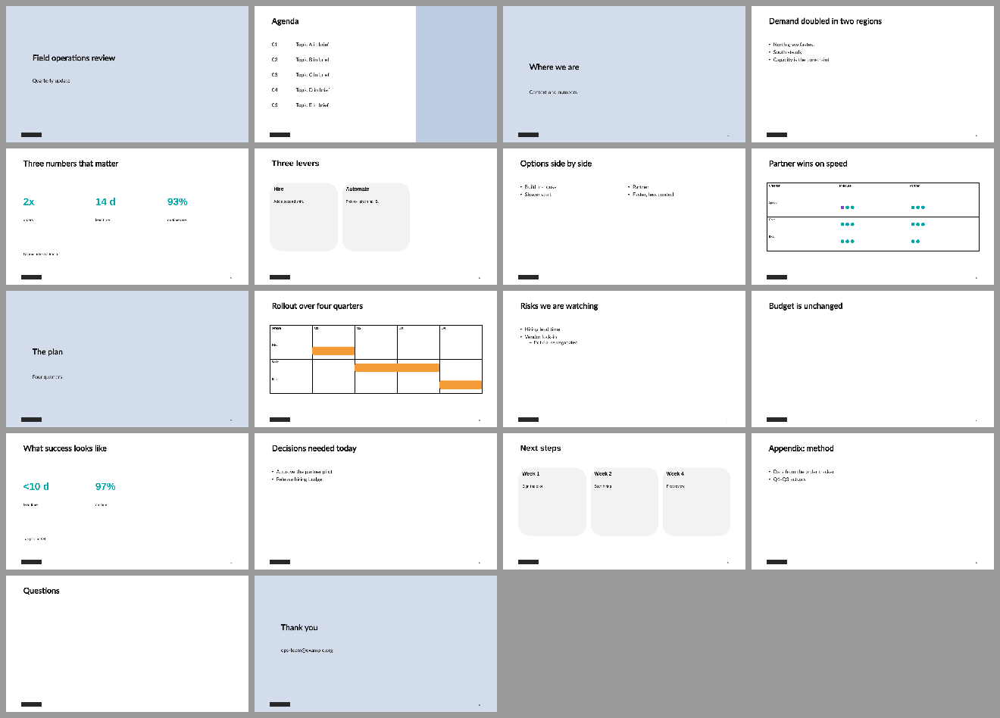

<p align="center">
  
</p>

# pptx-style

Agent skills for teams with a PowerPoint template: profile it into a machine-checkable style contract, then have your agent build and edit native, editable decks that stay inside it.

[](https://github.com/Paldom/pptx-style/actions/workflows/ci.yml)
[](LICENSE)
[](https://skills.sh/Paldom/pptx-style)

## Demo


The steps the skills run on a generated, brand-free template with real-world mess
(duplicate shape names, a non-English layout name, agenda numbers that exist only as
prompt text): the profile and its reusable patterns, an 18-slide build with 0 lint
errors, a rejected "neon pink in Comic Sans" request, and the diff that flags a
renamed, a deleted and a moved layout in template v2. Source: [`demo/demo.tape`](demo/demo.tape).



The built deck, rendered with LibreOffice. Every slide is a real template layout or a
clone of one of the template's own sample slides; the timeline bars are positioned from
the data, not drawn freehand. Regenerate with [`demo/render-sheet.sh`](demo/render-sheet.sh).

## Quick start

1. **[Required]** Install the skills:

   ```bash
   npx skills add Paldom/pptx-style
   ```

2. **[Required]** Profile your template once:

   ```text
   /pptx-style-profile templates/brand.potx
   ```

   You get `.pptx-style/brand/contract.json` and a generated `STYLE.md` next to your
   project: layouts and their fill keys, the sample slides worth reusing, where the logo
   and page number live, and what in the template trips up AI tools.

3. **[Required]** Ask for a deck in plain English:

   ```text
   Make a 12-slide quarterly review in our brand template from notes.md, with speaker notes.
   ```

   The agent plans the outline, shows you a two-slide preview, then builds the deck,
   checks text fit, lints it against the contract and renders a contact sheet.

4. **[Optional]** Edit an existing deck without touching the other slides:

   ```text
   In board.pptx, change slide 4's title to "Revenue up 12%" and leave everything else as is.
   ```

5. **[Afterward]** When the design team ships a new template version:

   ```text
   /pptx-style-profile templates/brand-v2.potx and diff it against our current contract
   ```

### Other ways to install

```bash
npx skills add Paldom/pptx-style -a codex -a pi   # target specific agents
gh skill install Paldom/pptx-style                # GitHub CLI >= 2.90
gh skill install Paldom/pptx-style <skill> --pin <tag>
```

```text
/plugin marketplace add Paldom/pptx-style
/plugin install pptx-style@pptx-style
```

Requirements: Python 3.10+ (standard library only). LibreOffice and poppler
(`pdftoppm`) are optional and only used for rendering previews; without them the
skills still build and lint, and say the visual check is owed.

## Skills

| Skill | Ask it when | Invoke |
| --- | --- | --- |
| [pptx-style-profile](skills/pptx-style-profile/) | You have a `.pptx`/`.potx` template and want its layouts, placeholders, theme, chrome and sample-slide patterns as a hashed contract, an AI-readiness audit, or a diff between two versions | `/pptx-style-profile brand.potx` |
| [pptx-style-build](skills/pptx-style-build/) | You want a new deck, extra slides or an edit in that template: real layouts, cloned sample slides, notes, fit and lint checks, a rendered preview | `/pptx-style-build 12-slide QBR from notes.md` |

## Workflow: from template to finished deck

The skills compose: profile once, build many times, re-profile when the template
changes. [docs/setup-prompt.md](docs/setup-prompt.md) is a paste-ready `/goal` that runs
the whole sequence with a gate after each skill: profile, parallel outline and layout
mapping, a preview you approve, the build, and a fresh-eyes review of the render.

What the contract enforces:

- **Native PPTX only.** Content goes into the template's own layouts and placeholders,
  or into clones of its sample slides (charts and their workbooks are copied per
  clone, so two charts never share data). No HTML conversion, no invented coordinates.
- **Facts from the file.** Theme colours, fonts, chrome positions and capacities are
  read from the template; inferred rules are labelled with the slides they came from.
- **Off-contract requests are refused.** Colours, fonts, positions and free text boxes
  are not part of the build spec; lint catches hand edits after the fact.
- **Drift fails loudly.** A changed template is re-checked against the contract;
  breaking changes stop the build with a readable diff.
- **Overflow is an error, not a shrink.** Text is measured with the theme font's real
  metrics; the fix order is shorten, move detail to the notes, then split.

Limits: the skills fill the layouts a template has; they do not design new ones.
Google Slides, Keynote and HTML decks are out of scope. Rendering is approximate when
a theme font is not installed.

## Repository structure

```
skills/                  # the two skills: SKILL.md + evals/ + scripts/ + references/
tests/                   # generated brand-free fixtures, acceptance suite, OFL test font
demo/                    # demo.tape, render script and the committed renders
docs/                    # setup prompt, authoring guide, eval methodology, README standard, deployment
scripts/                 # the gate: validator, eval scorer, self-checks
skills.sh.json           # skills.sh repo-page customization (groupings)
.claude/                 # agentic dev setup: hooks + bundled add-skill / publish-repo skills
.claude-plugin/          # plugin + marketplace manifests (makes this repo installable)
.local/                  # gitignored working area: sources, research, PROMPT.md
```

## Working on this repo with an agent

This repo is agent-native: canonical agent instructions live in
[AGENTS.md](AGENTS.md) (CLAUDE.md imports it), hooks validate and lint every write,
`make check` runs the full gate (validator, ruff, trigger evals, script self-tests and
the acceptance suite, no LibreOffice needed), and CI enforces the same on every PR.
The bundled `add-skill` skill walks the eval-first authoring workflow in
[docs/skill-authoring.md](docs/skill-authoring.md); the README shape is
[docs/readme-standard.md](docs/readme-standard.md). `make hooks` installs the
commit-time layer. Maintainers drive sessions with their own gitignored
`.local/PROMPT.md`.

## Contributing

Contributions welcome. See [CONTRIBUTING.md](CONTRIBUTING.md) for the skill-proposal
process, the authoring workflow, and the PR checklist. Please note the
[Code of Conduct](CODE_OF_CONDUCT.md).

## Support

Questions, ideas, or something not working? Start with [SUPPORT.md](SUPPORT.md).
Bugs and skill proposals have [issue templates](../../issues/new/choose), and
security concerns go through [SECURITY.md](SECURITY.md) (never a public issue).

## License

[MIT](LICENSE) © 2026 Paldom. The test font in `tests/fonts/` is Lato, under the
[SIL Open Font License](tests/fonts/OFL.txt).

<!-- attribution:start -->
---

[](https://github.com/Paldom/skillskit)

Scaffolded with [skillskit](https://github.com/Paldom/skillskit) — eval-first Agent
Skills tooling. This line is yours to delete; nothing checks for it.
<!-- attribution:end -->
